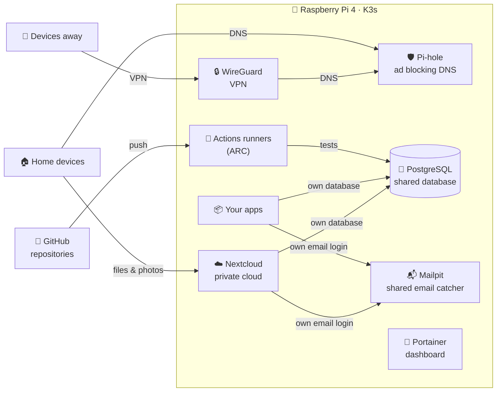

&nbsp;&nbsp;
&nbsp;&nbsp;
&nbsp;&nbsp;
 
&nbsp;&nbsp;
&nbsp;&nbsp;

# 🍓 NekkoRaspberry

**A home lab that fits in your hand.** 
One Raspberry Pi 4, running a small Kubernetes cluster, its own CI/CD runners, shared services for every app and private services for the home.

---

> [!NOTE]
> Everything here runs on **one small, silent, low-power computer** at home. No cloud servers, no monthly bills.
> The goal is a server that is **lightweight, secure and reliable enough to run 24/7**.

## 🖥️ The machine

| | |
|---|---|
| 🍓 **Hardware** | Raspberry Pi 4 Model B, 8 GB RAM |
| 💽 **Storage** | 128 GB |
| 🐧 **System** | Raspberry Pi OS Lite 64-bit (Debian 13), no desktop |
| ☸️ **Platform** | K3s, a lightweight Kubernetes |
| 🔌 **Access** | Headless, managed remotely from VS Code |
| 🌡️ **Footprint** | A few watts, around a third of its memory in use |

## 🧭 How it fits together

**One shared service, one private space per app.** Every app gets its own database and its own email login. Apps can't see each other's data, and each one can be added or removed on its own.

## 📦 Projects

| Project | What it does | Status |
|---|---|---|
| 🏃 [**ARC-SelfHosted-K3S**](https://github.com/NekkoRaspberry/ARC-SelfHosted-K3S) | GitHub Actions runners that run **on the Pi itself**, created on demand and removed after each job |  |
| 🐘 [**Postgres-K3s**](https://github.com/NekkoRaspberry/Postgres-K3s) | One PostgreSQL for all apps, with **one private database per app**, nightly backups and restore |  |
| 📬 [**Mailpit-K3s**](https://github.com/NekkoRaspberry/Mailpit-K3s) | Catches every email apps send and shows it in a web page, **tagged per app**. Nothing reaches real inboxes |  |
| 🛡️ [**Pihole-K3s**](https://github.com/NekkoRaspberry/Pihole-K3s) | DNS for the whole home network that **blocks ads and trackers** on every device, with local names for home services |  |
| 🔒 [**Wireguard-K3s**](https://github.com/NekkoRaspberry/Wireguard-K3s) | A VPN for **secure access to home from anywhere**, one key per device, with Pi-hole ad blocking on the go |  |
| ☁️ [**Nextcloud-K3s**](https://github.com/NekkoRaspberry/Nextcloud-K3s) | A private cloud for files and photos, **home network only**, using the shared PostgreSQL and Mailpit |  |

## ✨ How we build

<table>
<tr>
<td width="50%" valign="top">

### 🍃 Keep it light
Small images, memory limits on every service, and nothing running when it isn't needed. CI runners only exist while a job runs.

### 🔐 Security first
Services are reachable only inside the cluster or the home network; from outside, only through the WireGuard VPN. Passwords are generated at random and never stored in git. Each CI runner gets only the permissions its tests need.

</td>
<td width="50%" valign="top">

### 🧪 Tested, not assumed
Every project ships tests for health, scripts, deployment and cleanup, and the tests check that they leave nothing behind.

### 💾 Protect the data
Daily backups with automatic catch-up after downtime, one per day, kept for a week. Fewer disk writes to make the storage last longer.

</td>
</tr>
</table>

## 🗺️ Roadmap

- [x] Raspberry Pi OS Lite 64-bit
- [x] K3s, Helm and Portainer
- [x] Self-hosted GitHub Actions runners (ARC)
- [x] Shared PostgreSQL with per-app databases and backups
- [x] Shared Mailpit with per-app email logins
- [x] 🛡️ Pi-hole: block ads for the whole home network
- [x] 🔒 WireGuard: secure access from anywhere
- [x] ☁️ Nextcloud: a private cloud for files and photos
- [ ] 🚀 Build images and deploy apps automatically from GitHub

<b>🔍 Under the hood</b>

 

| Layer | Tools |
|---|---|
| Kubernetes | K3s, with Traefik and local storage built in |
| Packages | Helm |
| CI/CD | GitHub Actions + Actions Runner Controller (ARC) |
| Shared services | PostgreSQL 17, Mailpit |
| Home services | Pi-hole, WireGuard, Nextcloud |
| Management | Portainer, `kubectl`, VS Code over SSH |

Each project has its own README with install steps, commands and tests.

---

Built and run at home on a 🍓 Raspberry Pi · Lightweight · Secure · Reliable

